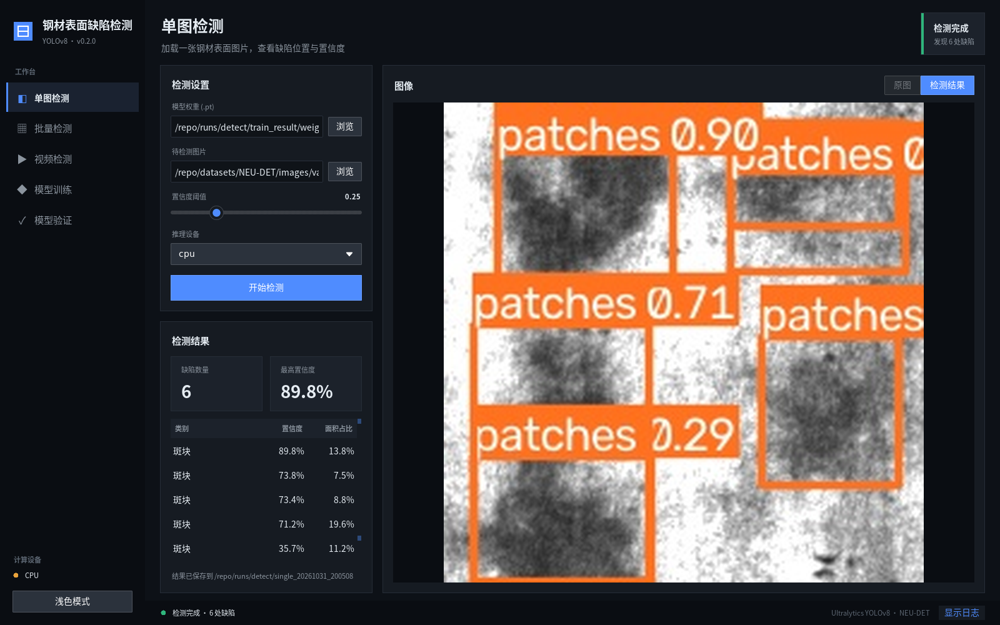
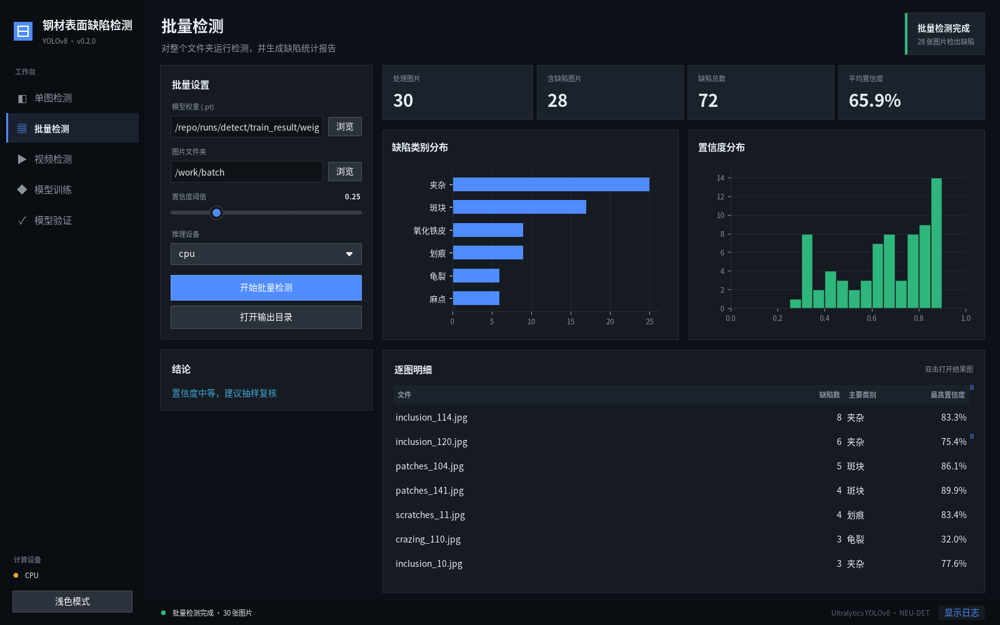
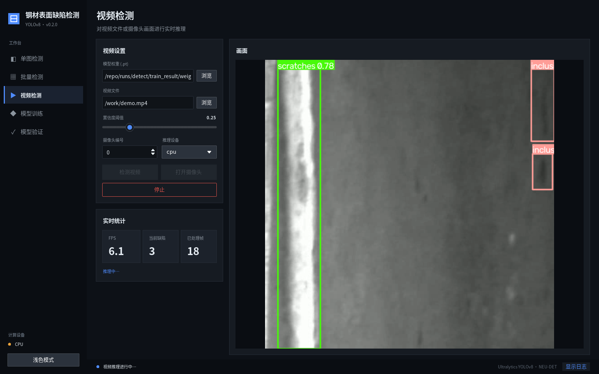
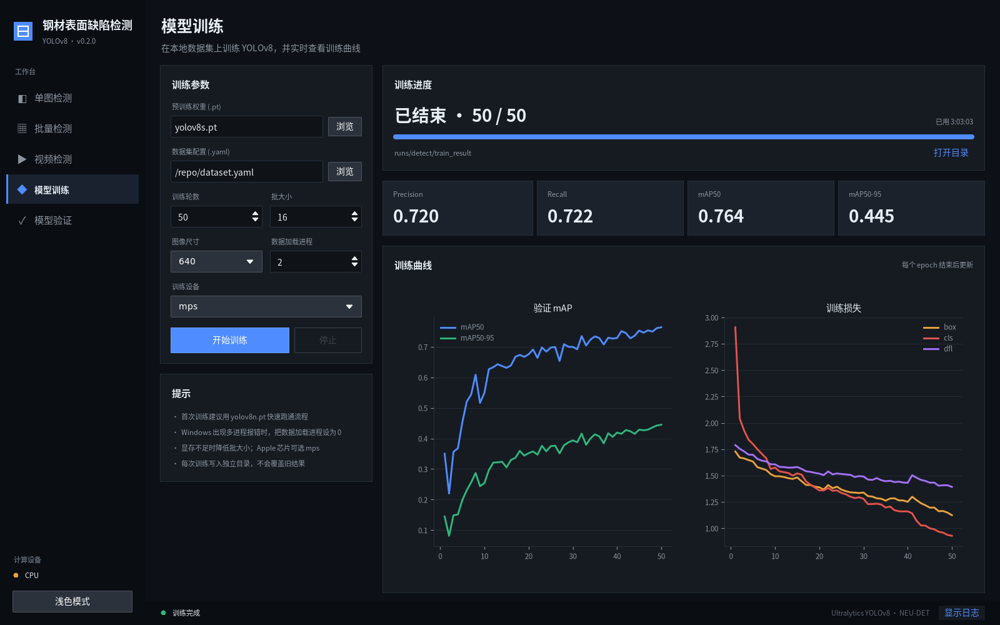
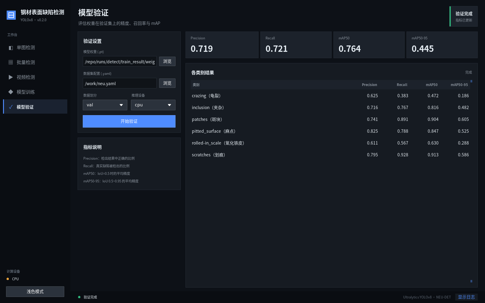
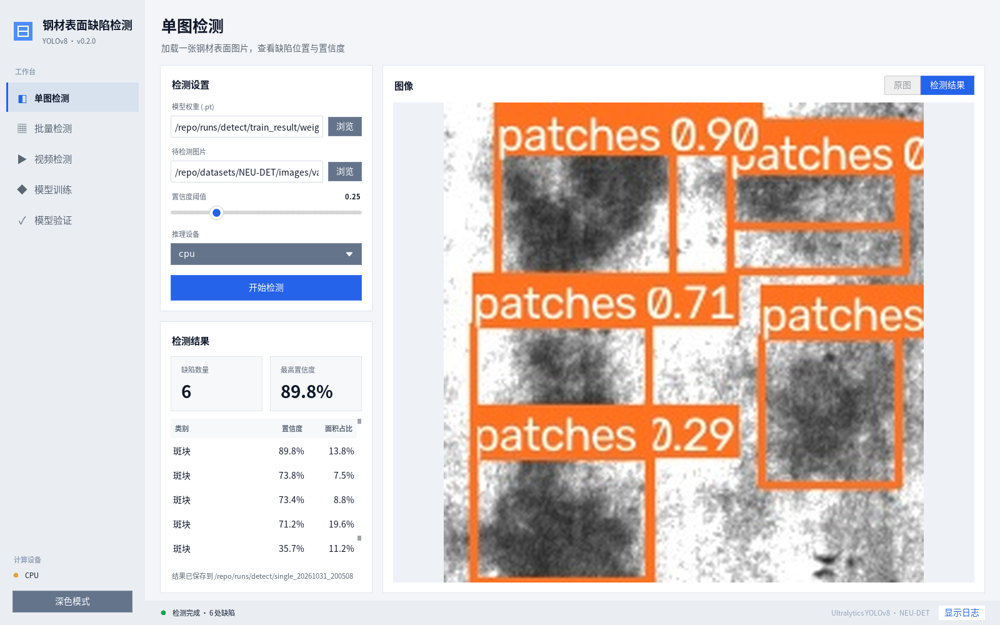

# 基于 YOLOv8 的钢材表面缺陷检测

用桌面 GUI 或命令行完成 YOLOv8 钢材表面缺陷检测的训练、验证与推理。

[English](README.md) | [简体中文](README.zh-CN.md)

[](https://github.com/YfengJ/steel-defect-detection/actions/workflows/ci.yml)
[](https://github.com/YfengJ/steel-defect-detection/releases)




本项目面向 NEU-DET 的 6 类钢材表面缺陷，是一个以学习为目的的项目。它覆盖完整流程：
VOC 标注转换、训练、验证、图片/文件夹/视频检测，以及在桌面应用里查看结果。
仓库不包含数据集和权重，请按 [docs/dataset.md](docs/dataset.md) 在本地准备。

## 功能亮点

- **桌面应用**：左侧导航工作台，支持深色和浅色主题，每个页面都能选择 CPU / Apple MPS / CUDA。
- **单图检测**：可在原图和检测结果间切换，逐条列出缺陷的置信度和面积占比。
- **批量检测**：给出文件夹级统计、类别分布图、置信度分布图和逐图明细；双击一行即可打开对应结果图。
- **视频与摄像头**：实时推理并自动丢弃积压帧，显示 FPS 和当前帧缺陷数。
- **模型训练**：每次训练写入独立目录，并根据 `results.csv` 实时绘制 mAP 和损失曲线；可在应用内停止训练。
- **模型验证**：显示整体 Precision / Recall / mAP，以及从 `val.py` 解析出的各类别结果。
- **命令行脚本**：每一步都有对应脚本，并在 CI 中测试（Ruff、单元测试、CLI smoke 测试、合成数据 CPU 训练/验证）。

## 快速开始

```bash
git clone https://github.com/YfengJ/steel-defect-detection.git
cd steel-defect-detection
python -m venv venv
source venv/bin/activate          # Windows: venv\Scripts\activate
python -m pip install --upgrade pip
python -m pip install -r requirements.txt
```

启动 GUI：

```bash
python ui.py
```

或用命令行检测单张图片：

```bash
python predict.py --model /path/to/trusted-best.pt --source /path/to/image.jpg --device cpu
```

结果保存在 `runs/detect/<name>/`。只加载来源可信的权重：PyTorch checkpoint 可能包含序列化的
Python 对象。macOS 用户请先阅读 [docs/macos.md](docs/macos.md)。如果想先不准备数据集跑通一次，
请参考 [docs/sample_inference.md](docs/sample_inference.md)。

## 界面一览

| 批量检测 | 视频检测 |
| --- | --- |
|  |  |
| **模型训练** | **模型验证** |
|  |  |

在侧边栏点一下即可切换到浅色主题：



截图使用下文 v0.1.3 YOLOv8s 基线权重，图片来自 NEU-DET 验证集；训练页展示的是该基线训练的
`results.csv`。

## 已复现基线

YOLOv8s、50 个 epoch、640 px、batch 16。在 Apple M5 (MPS) 上用本地 1,440 / 360 张图片的划分训练，
随后在 CPU 上对 822 个标注缺陷实例单独验证：

| Precision | Recall | mAP50 | mAP50-95 | mAP75 |
| ---: | ---: | ---: | ---: | ---: |
| 0.719 | 0.721 | 0.7637 | 0.4455 | 0.4530 |

| 缺陷类别 | Precision | Recall | mAP50 | mAP50-95 |
| --- | ---: | ---: | ---: | ---: |
| `crazing` 龟裂 | 0.625 | 0.383 | 0.472 | 0.1861 |
| `inclusion` 夹杂 | 0.716 | 0.767 | 0.816 | 0.4821 |
| `patches` 斑块 | 0.741 | 0.891 | 0.904 | 0.6045 |
| `pitted_surface` 麻点 | 0.825 | 0.788 | 0.847 | 0.5253 |
| `rolled-in_scale` 氧化铁皮压入 | 0.611 | 0.567 | 0.630 | 0.2883 |
| `scratches` 划痕 | 0.795 | 0.928 | 0.913 | 0.5864 |

这些数值只代表一个公开数据集划分，不代表工厂现场性能。环境、限制和权重校验值见
[实验日志](docs/experiments/yolov8s-neu-det-baseline.md) 和
[模型卡](docs/experiments/yolov8s-neu-det-v0.1.3-model-card.md)。权重本身未发布。

## 命令行使用

### 训练

```bash
python train.py --model yolov8n.pt --data dataset.yaml --epochs 50 --batch 16 --device cpu
python train.py --model yolov8n.pt --data dataset.yaml --epochs 50 --batch 8  --device mps
python train.py --model yolov8n.pt --data dataset.yaml --epochs 50 --batch 16 --device 0
```

| 参数 | 默认值 | 说明 |
| --- | --- | --- |
| `--imgsz` | `640` | 训练图片尺寸 |
| `--workers` | `2` | Windows 多进程报错时设为 `0` |
| `--project` / `--name` | `runs/detect` / `train_result` | 不会复用已有目录，新的训练会写入 `train_result2`、`train_result3`… |
| `--exist-ok` | 关闭 | 有意复用目录；这会覆盖旧权重，并把新指标追加到旧 `results.csv` |

训练结束时会打印最终权重路径。

### 验证

```bash
python val.py --model runs/detect/train_result/weights/best.pt --data dataset.yaml
python val.py --model best.pt --data dataset.yaml --split test --device cpu
```

`val.py` 会输出 Precision、Recall、mAP50、mAP50-95、mAP75 和各类别结果，并额外打印一行
`METRICS_JSON {...}`，供 GUI 等工具读取。

### 预测

```bash
python predict.py --model best.pt --source path/to/image.jpg --conf 0.25 --device cpu
python predict.py --model best.pt --source path/to/folder/ --name my_batch
```

标注后的图片和带置信度的 YOLO 标签保存在 `runs/detect/<name>/`。

### 视频

```bash
python video_predict.py best.pt path/to/video.mp4 --output output.mp4 --conf 0.25
python video_predict.py best.pt 0          # 摄像头 0
```

## 数据集准备

可使用 [NEU Surface Defect Database](http://faculty.neu.edu.cn/songkechen/zh_CN/zdylm/263270/list/)
或类别映射相同的数据集：

```text
datasets/NEU-DET/
├── images/{train,val,test}/
├── labels/{train,val,test}/
└── annotations/            # 可选，VOC XML
```

YOLO 标签格式为 `class_id x_center y_center width height`，坐标归一化到 `0.0`–`1.0`。
如需转换 VOC XML 标注，运行：

```bash
python translate.py
```

脚本会为每个已存在的 `images/<split>` 目录生成 `labels/<split>/`。`dataset.yaml` 中的 `path`
相对于 YAML 文件自身解析。完整说明见 [docs/dataset.md](docs/dataset.md)。

| ID | 类别 | 含义 |
| --- | --- | --- |
| 0 | `crazing` | 龟裂 |
| 1 | `inclusion` | 夹杂 |
| 2 | `patches` | 斑块 |
| 3 | `pitted_surface` | 麻点 |
| 4 | `rolled-in_scale` | 氧化铁皮压入 |
| 5 | `scratches` | 划痕 |

## 项目结构

```text
steel-defect-detection/
├── ui.py                  # 桌面 GUI（ttkbootstrap）
├── gui_logic.py           # 不依赖界面的 GUI 逻辑：标签解析、批量统计、指标解析
├── train.py               # 训练 CLI
├── val.py                 # 验证 CLI
├── predict.py             # 图片 / 文件夹预测 CLI
├── video_predict.py       # 视频与摄像头推理 CLI
├── translate.py           # VOC XML → YOLO TXT 转换
├── path_validation.py     # 本地路径与数据集 YAML 检查
├── dataset.yaml           # 默认数据集配置
├── requirements*.txt      # 运行与开发依赖
├── tests/                 # 单元、GUI 回调、CLI 与训练 smoke 测试
├── docs/                  # 安装、数据集、实验与维护文档
└── ultralytics/           # 内置 Ultralytics 8.0.182
```

`datasets/`、`runs/`、`weights/` 和 `*.pt` 文件均被 git 忽略。

## 兼容性说明

- 内置 **Ultralytics 8.0.182**，以保证原始运行环境可复现。`ultralytics/`、大部分 `docs/` 和通用
  `examples/` 来自采用 AGPL-3.0 的 [Ultralytics 项目](https://github.com/ultralytics/ultralytics)，
  对这部分核心代码的修改会保持保守。
- **PyTorch < 2.6**：更新版本的 `torch.load` 默认行为与该权重加载器不兼容。
- **NumPy < 2.4**：内置指标代码仍调用 `numpy.trapz`。
- **ttkbootstrap 1.10+ 与 2.x** 均可使用，GUI 会注册自己的主题。

## 项目文档

- [macOS / Apple Silicon](docs/macos.md) · [示例推理](docs/sample_inference.md) ·
  [数据集准备](docs/dataset.md) · [常见问题](docs/troubleshooting.md)
- [基线实验日志](docs/experiments/yolov8s-neu-det-baseline.md) ·
  [v0.1.3 模型卡](docs/experiments/yolov8s-neu-det-v0.1.3-model-card.md) ·
  [模型卡模板](docs/model_card.md)
- [GUI 检查清单](docs/gui-smoke.md) · [Roadmap](ROADMAP.md) · [Release Notes](RELEASE_NOTES.md)
- [贡献指南](CONTRIBUTING.md) · [行为准则](CODE_OF_CONDUCT.md) · [Support](SUPPORT.md) ·
  [Security](SECURITY.md)

## 社区参与

欢迎提交真实的错误报告、复现记录和范围清晰的 Pull Request。可以在
[复现报告 Discussion](https://github.com/YfengJ/steel-defect-detection/discussions/57)
分享经过测试的环境和结果。如果项目对你的学习有帮助，欢迎 Star 支持继续维护；请不要互刷 Star。

## License

[AGPL-3.0](LICENSE)。YOLOv8 来自 [Ultralytics](https://github.com/ultralytics/ultralytics)，遵循其上游协议。
